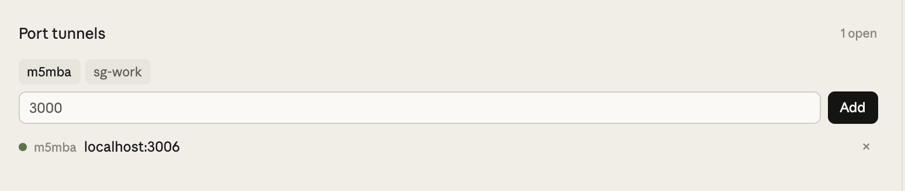

# Herdr Port Forwarder



Port tunnels for the [Herdr](https://herdr.dev) desktop app. When a terminal on a remote machine prints a `localhost` URL, this mod opens an `ssh -L` tunnel for that port and lists it in a panel. Click the row to open the local address in your browser. The tunnel closes when the terminal that printed it ends.

- **Detects dev servers automatically.** It reads the last lines of remote terminals for `http://localhost:3000`, `http://127.0.0.1:5173`, `http://0.0.0.0:8080`, and the IPv6 loopback forms, then tunnels each port once.
- **Waits for the server.** A URL often appears before the port listens, so it checks with `ss` or `lsof` and retries for a few seconds.
- **Manual tunnels too.** Pick a connected machine, type a port, press Add. The same tunnel can be opened without a terminal printing anything.
- **Follows lifecycle.** Ending the source terminal closes its tunnel. Ending the `ssh` terminal removes the row. A dismissed tunnel stays dismissed until no terminal shows that URL any more.
- **Survives a reload.** Tunnels started in the background are adopted on reload instead of being left behind or duplicated.
- **One panel, several machines.** Machine chips pick the target for manual tunnels; detected tunnels use the machine the terminal belongs to.

## Requirements

- Herdr desktop app 0.1.14 or newer. The mod's `herdr-app check` passes on 0.1.14.
- One or more remote machines added under Settings → Machines, reachable with non-interactive SSH. The tunnel runs `ssh -N -o BatchMode=yes`, so key-based auth must already work.
- `ssh` on the computer running Herdr. On the remote machine, `ss` or `lsof` is used when available; if neither exists, the mod assumes the port is listening and lets `ssh` report the real error.

## Install

Clone the repository and link the mod into Herdr's home:

```sh
git clone https://github.com/ohblue/herdr-port-forwarder.git ~/Documents/github.com/ohblue/herdr-port-forwarder
ln -s ~/Documents/github.com/ohblue/herdr-port-forwarder/mods/port-forwarder ~/.config/herdr-app/mods/port-forwarder
```

Herdr does not notice file changes inside a symlinked mod folder, so after a `git pull` restart Herdr or recreate the link.

`mods/port-forwarder/mod.json` says `{ "place": "none" }`: Herdr only shows the mod where a layout or a command puts it. Either split it beside a terminal for a quick look:

```sh
herdr-app do pane.split:right --mod port-forwarder
```

or add a block to your layout where you want it to stay. Inside a stack:

```json
{
  "id": "ports",
  "type": "block",
  "content": { "mod": "port-forwarder" }
}
```

Use exactly one copy in your layout. Each visible or hidden copy in a layout runs the watchers, and two copies would race on the same shared state.

## Use

The panel lists connected machines as chips, a port input, and an Add button. Above them, `Port tunnels` and a count show how many tunnels are open.

- **Automatic:** start a dev server in a terminal on a remote machine. When the URL appears, a row like `laptop localhost:3000` appears. A notification says the tunnel is ready.
- **Manual:** choose a machine, type the remote port, press Add. If the remote port is already tunneled, it replaces the old tunnel.
- **Open:** click the row. It runs `open` on macOS or `xdg-open` elsewhere with the local URL.
- **Close:** click ×. The tunnel is dismissed and will not reopen while any terminal still shows that URL.

Local ports start at the remote port and move up to 19 ports if the local one is busy. The tunnel is an `ssh -L 127.0.0.1:<local>:localhost:<remote>` connection.

## Security

Mods are trusted code, not sandboxed extensions. This mod:

- reads terminal output with `hc read` and waits on terminal output with `hc wait`;
- starts and kills terminals with `hc run` / `hc kill`;
- runs `ssh`, `ss`, `lsof`, `sleep`, and `open`/`xdg-open`;
- uses the network through `ssh` to the machine you configured;
- keeps its state in Herdr's shared state under the key `port-forward`.

It does not read files outside its own folder and does not send terminal text anywhere. The panel reads the last 40 lines of remote terminals to find URLs.

## License

MIT. See [LICENSE](LICENSE).
