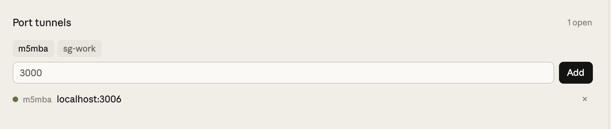

# Herdr Port Forwarder

Port tunnels for the Herdr desktop app. A remote terminal that prints a `localhost` URL gets an `ssh -L` tunnel for that port; a panel lists the tunnels and opens them in the browser. Tunnels close when the terminal that printed the URL ends.

## What you see

A panel with 12px padding and a 10px gap, 12px text in `foreground`.

- **Header**, one row: `Port tunnels` in 13px semibold, and on the right `N open` in 10.5px `dim`.
- **Machine chips**, one per connected machine (`machines()` with a name and `layout === "ready"`), 22px high, 7px horizontal padding, 5px corners, 11px text. The selected chip uses `selected` with `foreground`; the others use `raised` with `muted`. They wrap.
- **Port input and Add**, one row: a 28px input, flexible width, 8px horizontal padding, 6px corners, 1px border (`accent` when focused, `input` otherwise), `background` fill, 12px text. The Add button is 28px high, 10px horizontal padding, 6px corners, `solid` fill, `solid_foreground` text, 11.5px medium. It says `…` while a manual tunnel starts.
- **Tunnel rows**, each a name line and an optional error line. The name line is a 7×7 dot with 4px corners — `done` when the tunnel is up, `blocked` when it errored — then the machine name in 10.5px `dim`, then `localhost:<localPort>` in 12px `foreground`. A 20×20 `×` on the right has 5px corners, `dim` text and a `hover` background. Hovering the link also uses `hover`.
- **Errors**: the row's error is 11px `blocked`, indented 13px, truncated to one line. Form errors (`Port must be 1–65535.`, `No connected machine.`) sit under the input in 11px `blocked`.
- **Empty state**: when no tunnel is open, `Tunnels appear here when a remote terminal prints a localhost URL.` in 11px `dim`. When no remote machine is connected, the chip row says `No connected machines.` in 11px `dim` and Add reports `No connected machine.`

The list scrolls vertically when it overflows. The form stays above it.

## How it behaves

- **Which terminals are watched.** A terminal is remote when its address contains `/` and the part before it names a machine whose layout is `ready`. Local terminals are ignored: there is nowhere to forward from.
- **Agent terminals.** A terminal with `status` is read once when its state or turn changes; a change during a read makes it read again. The key is `state|turn`; `msg` changes on every tool call and is deliberately left out.
- **Program terminals.** It calls `hc wait <address> --output "://" --timeout 25 --json`. On `reason: "output"` it waits 2 seconds for a burst of URL lines, then reads. On `timeout` it waits again. Any other end (the terminal is gone or blocked) parks the watch; it is not retried until a new state change.
- **Reading.** `hc read <address> --lines 40`; every unique port found in the last 40 lines is considered. Recognized URLs are `http(s)://` followed by `localhost`, `127.0.0.1`, `0.0.0.0`, `[::1]`, or `::1`, then `:port` (2 to 5 digits, validated to 1–65535).
- **Automatic tunnel.** For each shown port, if no tunnel and no dismissal exists for `<machine>:<port>`, it checks whether the remote port listens: `ss -ltnH`, then `lsof -nP -iTCP -sTCP:LISTEN`. If neither runs, it assumes yes. A port that is not listening yet is retried after 1, 2, and 4 seconds, then dropped until the URL is printed again.
- **Opening.** It runs `hc run --bg --json --no-parent --no-notify --name pf-tunnel-<machine>-<localPort> -- ssh -N -o ExitOnForwardFailure=yes -o BatchMode=yes -o ServerAliveInterval=15 -o ServerAliveCountMax=3 -L 127.0.0.1:<local>:localhost:<remote> <target>`. `<target>` comes from `hc machine ls --json`; a machine with `via` is refused as a custom connection.
- **Local port choice.** It starts at the remote port. If the local `ssh` reports `Address already in use`, it tries the next port, up to 19 more. Any other failure is stored on the row and left for the person to dismiss.
- **Ready check.** `ssh` reports a live terminal before its forward listens, so the mod polls local `lsof -nP -iTCP:<port> -sTCP:LISTEN` every 300ms, up to 20 times, and also checks that the terminal is still `live`. Only then is the record written and `Tunnel ready` notified. If local `lsof` is unavailable, it treats the forward as ready.
- **Manual tunnel.** The selected chip is the machine of the focused space when that machine is in the list, otherwise the first connected machine. Add parses the port, replaces an existing tunnel for the same id, clears its dismissal, creates the tunnel, and leaves the field empty on success. The machine chips do not change which machine an automatic tunnel uses.
- **Rows.** Clicking the link opens the stored `http://localhost:<localPort>` with `open` on macOS or `xdg-open` elsewhere. Clicking × kills the tunnel terminal, removes the row, and adds the id to `dismissed`.
- **Dismissal.** An id leaves `dismissed` only when no watched terminal shows that machine and port any more. If another terminal still shows the URL, it stays dismissed; once every terminal stops showing it, the next print can open it again.
- **Ending.** The row is removed when the source terminal or the `ssh` terminal is no longer live. Cleanup asks `hc get` before killing, because the terminal list can trail a tunnel that just started. On startup it also sweeps `pf-tunnel-*` terminals that no record knows about, which cleans up a build that died mid-start.
- **Reload.** After a reload it adopts tunnels whose `ssh` terminal is still live and whose argv still contains the expected `-L` value; the rest are forgotten. Shared state is the canonical `{ tunnels, dismissed }` shape; invalid entries are dropped and keys are kept in one order.
- **Overlay copies.** A copy opened with `mod.open` renders nothing; the copy in the layout owns the tunnels. `herdr.checking()` returns true on Herdr 0.1.14 during `herdr-app check`, so a check does not sweep real tunnels.

## Built from

- **Mod** `mods/port-forwarder/`: `main.js` is a `View` exported from `gpui-kit`, with `v_flex`, `h_flex`, `div`, `InputState`, and `Input`. `tunnels.js` holds pure helpers (URL parsing, `ss`/`lsof` parsing, canonical state, `-L` value, terminal names, `lane()` for serial work) and imports nothing from `herdr`, so it can be tested under plain node.
- **Mod metadata** `mods/port-forwarder/mod.json`: `{ "place": "none" }`. It is only shown where a layout block or `pane.split` puts it.
- **herdr** imports: `exec`, `focused`, `hc`, `machines`, `notify`, `props`, `setShared`, `shared`, `spaces`, `terminals`, `theme`, `window`, and `checking`.
- **hc calls**: `run --bg --json --no-parent --no-notify --name`, `wait --output --timeout --json`, `read --lines`, `get --json`, `kill`, `rm`, `machine ls --json`.
- **Programs**: `ssh` (through `hc run`), `ss`, `lsof`, `sleep`, `open` / `xdg-open`.
- **Shared state**: one key, `port-forward`, shared by every connected screen and machine.
- **No keys.json.** Every action is a click; there are no key bindings to merge.
- **Layout placement**: a block with `content: { "mod": "port-forwarder" }`. The original setup puts it in a stack beside Files, Changes, and Pull requests in a 368px panel.

## Watch out

- **Use one copy.** Two layout copies both run the watchers and race on the shared state. Only `mod.open` copies are skipped.
- **Non-interactive SSH only.** `BatchMode=yes` means a password prompt cannot work, and a machine with a custom `via` is refused. Set up key auth in Herdr first.
- **Only remote terminals.** A local terminal's `localhost:3000` is already local; the mod ignores it.
- **Only the last 40 lines.** A URL that scrolled away is not re-detected. The tunnel stays open until the terminal ends or × is clicked.
- **Servers that start late.** Detection retries for 1+2+4 seconds. A server that takes longer needs the URL printed again.
- **Local port drift.** If the remote port is busy locally, the local port moves up to 19 higher. The row always shows the real local port.
- **No `ss`/`lsof` on the remote.** The mod assumes the port is listening; a wrong assumption becomes an `ssh` error on the row.
- **The panel must stay in the layout.** A hidden block's copy still runs (Herdr keeps layout copies alive), but removing the block stops the watchers. Tunnels already open remain until their terminals end; the sweep on the next start cleans up leftovers.
- **URL text is untrusted.** Only the port number is taken from terminal text; the URL opened is built from `localhost` and that port, never from the printed host.
- **Herdr version.** Built and checked on 0.1.14. Older versions run `init` during `herdr-app check` with empty shared state and could sweep real tunnels; the `checking()` guard is what avoids that. If a future version changes `hc wait`'s JSON or the terminal shape, the watchers are the first thing to recheck.

## Done when

- `herdr-app check ~/.config/herdr-app/mods/port-forwarder` passes.
- With a remote machine connected, a terminal there printing `http://localhost:3000` while a server listens adds a row `localhost:3000`, opens it on click, and shows a `Tunnel ready` notification.
- × removes the row and its `ssh` terminal; it does not come back while that URL is still on screen; after the URL scrolls away, printing it again opens a new tunnel.
- Ending the terminal that printed the URL closes its tunnel and removes the row.
- Typing a port and pressing Add opens a tunnel without any terminal printing a URL.
- A port outside 1–65535 shows `Port must be 1–65535.`; no connected machine shows `No connected machine.`
- Reloading Herdr keeps an open tunnel's row and does not start a second `ssh` for it.
- `herdr-app status` shows no mod errors.
